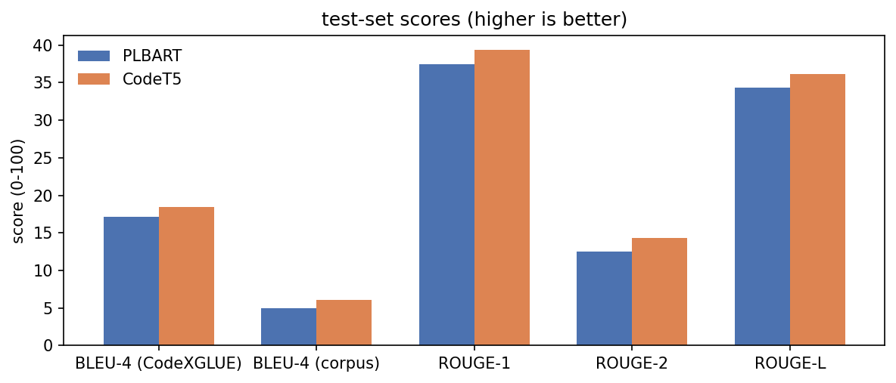
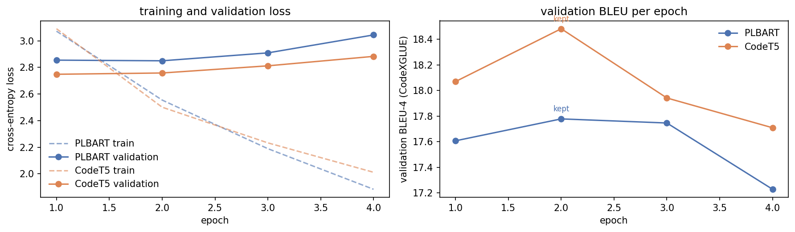
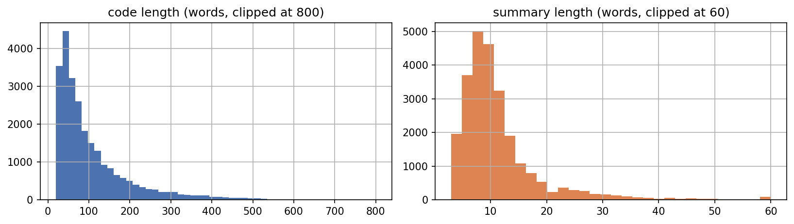

# Neural Code Summarization: PLBART vs. CodeT5

Fine-tuning and comparing two pre-trained code-aware encoder-decoder transformers, **PLBART** and
**CodeT5**, on the Python subset of the **CodeXGLUE code-to-text** benchmark. Given the body of a
Python function, the models write a one-sentence natural-language summary of it, the kind of line
that opens a docstring.

The whole experiment lives in one self-contained notebook,
[`code_summarization.ipynb`](code_summarization.ipynb), which runs end to end on a free Kaggle T4 GPU.

## Highlights

- **About 90% of the full-data leaderboard score with a tenth of the data.** On the official
  CodeXGLUE metric, CodeT5 reaches 18.4 BLEU and PLBART 17.2, against published full-data scores of
  20.0 and 19.3.
- **Leaderboard-comparable evaluation.** BLEU is computed with a re-implementation of the official
  CodeXGLUE evaluator. In an earlier run, a naive whitespace-split BLEU made PLBART look 4.7 points
  worse than CodeT5, purely because of spacing around punctuation.
- **Careful model selection.** The checkpoint with the best validation BLEU is kept, and the test set
  is scored exactly once per model.
- **Reproducible.** Fixed seeds, all hyper-parameters in one cell, and a measured check that the
  target docstring never appears in the model input.

## Contents

- [Results](#results)
- [Dataset](#dataset)
- [Method](#method)
- [Methodology checks](#methodology-checks)
- [Running the notebook](#running-the-notebook)
- [Using a fine-tuned model](#using-a-fine-tuned-model)
- [Repository layout](#repository-layout)
- [References](#references)

## Results

Test-set scores on a seeded 10% sample of the CodeXGLUE Python test split (1,491 functions), after
fine-tuning on a 10% sample of the training split (25,182 functions). All scores are on a 0-100 scale.

| model | BLEU-4 (CodeXGLUE) | BLEU-4 (corpus) | ROUGE-1 | ROUGE-2 | ROUGE-L |
|---|---|---|---|---|---|
| PLBART | 17.17 | 4.99 | 37.48 | 12.48 | 34.28 |
| **CodeT5** | **18.40** | **6.06** | **39.35** | **14.37** | **36.14** |
| *PLBART, full data, published* | *19.30* | | | | |
| *CodeT5-base, full data, published* | *20.01* | | | | |

The published rows are the CodeXGLUE leaderboard numbers for fine-tuning on the full training split
and evaluating on the full test split, so the comparison is indicative rather than exact. Validation
scores are in [`results/results.csv`](results/results.csv). The test scores can be recomputed from
[`results/test_predictions.csv`](results/test_predictions.csv) with the metric functions in
Section 3.2 of the notebook.



**What the numbers say**

- **CodeT5 is ahead on every metric, by a small margin.** The gap is about 1.2 BLEU and 1.9 ROUGE
  points.
- **Corpus BLEU is low because the summaries are short.** Both models average about 7 tokens per
  summary, against 12 for the references, which often add a second sentence of detail. Corpus-level
  BLEU applies one brevity penalty to the whole test set, so it punishes this heavily. The
  per-example CodeXGLUE BLEU is the more informative score and the one the leaderboard uses.
- **Both models overfit within a few epochs.** Training loss keeps falling, but validation BLEU peaks
  after epoch 2 and declines from epoch 3, so early stopping ends training after epoch 4.
- **BLEU is the better selection signal.** For CodeT5, validation loss was lowest after epoch 1,
  while validation BLEU peaked after epoch 2, at 18.48 against 18.07. Selecting on loss would have
  kept the weaker checkpoint. For PLBART both criteria picked epoch 2.



**Example predictions** from the test set:

| reference | PLBART | CodeT5 |
|---|---|---|
| Get the public key of the certificate . | Get the public key for this certificate. | Get the public key for this certificate . |
| Lookup an Amazon Product . | Lookup an Amazon Product. | Lookup an Amazon Product . |
| Extracts file information from kwargs . | Extracts the information from the SRVC file. | Extract file information from kwargs . |
| Remove old entries from the cache | Remove old cachedir entries. | Remove old entries from a cachedir . |
| Starts redirection of stdout | Start the program. | Establish a redirection of stdout . |
| Define a configuration section handling config file . | Create a config section. | Return a dictionary of configuration options . |

All 1,491 test predictions from both models are in
[`results/test_predictions.csv`](results/test_predictions.csv).

## Dataset

[CodeXGLUE code-to-text](https://huggingface.co/datasets/google/code_x_glue_ct_code_to_text)
(Python configuration), derived from CodeSearchNet.

| split | full size | used (10%) |
|---|---|---|
| train | 251,820 | 25,182 |
| validation | 13,914 | 1,391 |
| test | 14,918 | 1,491 |

Following the benchmark's recipe, the input is `code_tokens` (the function tokenized with its
docstring and comments removed) and the target is `docstring_tokens` (the tokenized first paragraph
of the docstring). Each split is shuffled with a fixed seed before sampling, because the dataset is
ordered by repository.



## Method

| | PLBART | CodeT5 |
|---|---|---|
| checkpoint | `uclanlp/plbart-base` | `Salesforce/codet5-base` |
| architecture | BART-style denoising seq2seq, pre-trained on Java, Python and English | T5 pre-trained on code with identifier-aware objectives |
| parameters | 139M | 223M |
| batch size | 16 | 8 |

Shared setup:

- maximum input length 384 tokens and maximum summary length 128 tokens, with dynamic padding;
- AdamW with learning rate 3e-5 and weight decay 0.01, linear warm-up over 6% of steps then linear decay, gradient clipping at 1.0;
- up to 10 epochs; after each epoch the validation set is decoded, the checkpoint with the best validation BLEU is kept, and training stops after 2 epochs without improvement;
- beam search with 4 beams;
- metrics: BLEU-4 as computed by the CodeXGLUE evaluator, corpus-level BLEU-4 on the same tokens, and mean ROUGE-1/2/L F-measure.

Both checkpoints are pre-trained only. The Hugging Face Hub also hosts variants already fine-tuned for
this task, such as `uclanlp/plbart-python-en_XX` and `Salesforce/codet5-base-multi-sum`. They are
deliberately not used, since fine-tuning them again would measure nothing.

## Methodology checks

Code summarization is easy to get wrong in ways that inflate or distort scores silently. The notebook
handles each of these explicitly:

| concern | decision |
|---|---|
| Target visible in the input | The raw `code` field contains the docstring, so the input is `code_tokens` instead. The notebook measures the overlap: the target appears in 100% of raw `code` fields and in under 1% of `code_tokens` inputs. |
| Task-fine-tuned starting checkpoints | Only pre-trained checkpoints are used. |
| Unrepresentative subset | Splits are shuffled with a fixed seed before sampling. |
| Loss on padding | Labels are padded with `-100`, which the loss ignores. |
| Train/inference mismatch in PLBART | Targets end with the `__en_XX__` language code, the same token the decoder is started with. |
| Overfitting | Model selection and early stopping on validation BLEU; the best epoch is evaluated, not the last. |
| Test-set reuse | Model selection uses the validation set only; the test set is scored once per model. |
| Metric tokenization | BLEU uses the CodeXGLUE normalization, so `stream.` and `stream .` count as the same tokens. |
| Reproducibility | Global seed, seeded shuffling and data-loader order, all hyper-parameters in one configuration cell. |

## Running the notebook

The notebook targets Kaggle and was run on its current image (Python 3.13, PyTorch 2.11,
transformers 5.20, datasets 4.8). It also runs on transformers 4.4x.

1. Create a Kaggle notebook and import `code_summarization.ipynb` with *File → Import Notebook*.
2. In *Settings*, set **Accelerator** to *GPU T4 x2* or *GPU P100* and turn **Internet** *On*.
   The dataset and model weights are downloaded from the Hugging Face Hub.
3. *Run All*. With the default 10% sample, the run takes about 1.5 to 2.5 hours on a T4.
   Setting `SUBSET_FRACTION = 0.01` gives a quick run of about 20 minutes.
4. From the *Output* tab, `results/` holds the metrics, test predictions and figures, ready to copy
   into this repository. `checkpoints/` holds the fine-tuned weights, about 1.4 GB.

Everything Kaggle-specific is marked with a `# Kaggle:` comment in the notebook. To run elsewhere,
use a GPU with 16 GB of memory and install:

```bash
pip install torch transformers datasets sentencepiece rouge-score nltk pandas matplotlib
```

## Using a fine-tuned model

The saved checkpoints are standard Hugging Face models. Section 7 of the notebook defines a
`summarize()` helper that applies the training preprocessing to raw source code: it strips
docstrings with `ast` and tokenizes with Python's own tokenizer.

```python
from transformers import AutoModelForSeq2SeqLM, AutoTokenizer

tokenizer = AutoTokenizer.from_pretrained("checkpoints/codet5")
model = AutoModelForSeq2SeqLM.from_pretrained("checkpoints/codet5")

print(summarize(source_code, model, tokenizer))   # summarize() is defined in the notebook
```

On the function `check_file_balance`, which checks that every opening parenthesis in a file is
closed, the fine-tuned CodeT5 writes "Check if the file is balanced."

For the PLBART checkpoint, also pass `decoder_start_token_id=tokenizer.convert_tokens_to_ids("__en_XX__")`
so the decoder starts with the English language code.

## Repository layout

```
code_summarization.ipynb      the complete experiment, with outputs from the Kaggle run
results/
  results.csv                 validation and test scores for both models
  test_predictions.csv        reference and both models' summaries for every test example
  figures/                    figures produced by the notebook
README.md
LICENSE                       MIT
```

The fine-tuned weights are not stored in the repository because of their size.

## References

- Lu et al., *CodeXGLUE: A Machine Learning Benchmark Dataset for Code Understanding and Generation*, 2021.
- Ahmad et al., *Unified Pre-training for Program Understanding and Generation* (PLBART), NAACL 2021.
- Wang et al., *CodeT5: Identifier-aware Unified Pre-trained Encoder-Decoder Models for Code Understanding and Generation*, EMNLP 2021.
- Husain et al., *CodeSearchNet Challenge: Evaluating the State of Semantic Code Search*, 2019.

## License

MIT, see [LICENSE](LICENSE).
